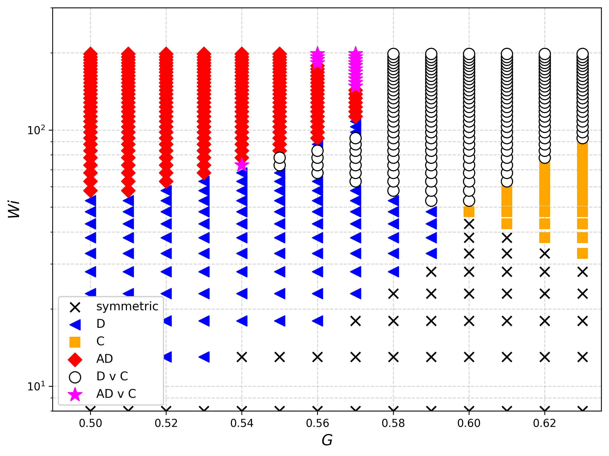

# Learning Viscoelastic Flow Normal Form

Code for reproducing the polynomial and neural-network normal-form models
of viscoelastic flow past two microcylinders, fit to the experimental
data of Hopkins et al. (PRL 2021). Each script trains one model variant
from the paper, solves for its equilibria, and reproduces the
corresponding bifurcation diagram / phase diagram figures.

## Results

Phase diagram from `neural_network_symmetry_projected_negative_c_refinement.py`,
the best-performing model among those in this repository:



## Scripts

| Script | Model |
|---|---|
| `polynomial_unrestricted_no_augmentation.py` | Fully unrestricted polynomial normal form, no reflection-symmetry constraint, no data augmentation. Reports only the bifurcation diagram (no phase diagram); this ablation already shows substantial discrepancies at the level of its equilibrium branches, so a phase diagram is not reported for it. |
| `polynomial_symmetry_restricted_no_augmentation.py` | Polynomial normal form restricted to even-in-`I''` terms in `f1` / odd-in-`I''` terms in `f2`, trained on the original equilibrium observations without data augmentation. This is the paper's final reported polynomial model: reflected-data augmentation was also tested but produced no further improvement, so it is not used. Reports bifurcation diagram and phase diagram. |
| `neural_network_direct.py` | Direct neural-network vector field (shared trunk + two heads), no symmetry constraint. Reflected-data augmentation was tested and found to make the reconstruction worse, so it is not used. |
| `neural_network_symmetry_projected.py` | Symmetry-projected neural-network vector field: the network output is reflection-averaged so that `f1` is exact even and `f2` is exact odd in `I''`. Trained without data augmentation, since the exact projection makes it redundant. |
| `neural_network_symmetry_projected_negative_c_refinement.py` | Same symmetry-projected network as above, plus an iterative fine-tuning stage that penalizes spurious stable "C" equilibria found in a specific `(G, Wi)` sub-region. |

## Data

All scripts read `data/data_flow.xlsx` (columns `G`, `Wi`, `I'`, `I''`),
the experimental equilibrium observations the models are fit to. This
file is not included in the repository; please contact the author for
access to the data.

## Running

Run from the repository root, so the scripts can find `data/data_flow.xlsx`:

```bash
python3 code/neural_network_symmetry_projected.py
```

Each script creates its own output subfolder under `paper_figures/<script_name>/`
containing the trained model's root CSVs and the bifurcation-diagram /
phase-diagram PNG + EPS figures.

The NN scripts are self-contained (training + equilibrium search via
`scipy.optimize.root`). The polynomial scripts additionally solve for
equilibria via [Bertini](https://bertini.nd.edu/) (homotopy
continuation), and expect a local Bertini installation, configured near
the top of `__main__`:

```python
bertini_exec = "/path/to/BertiniApple_v1.7/bertini"
bertini_workdir = Path("/path/to/BertiniApple_v1.7/examples/viscoelastic_flow")
```

Install Bertini separately and edit these two paths to point to your
own installation before running `polynomial_unrestricted_no_augmentation.py`
or `polynomial_symmetry_restricted_no_augmentation.py`.
